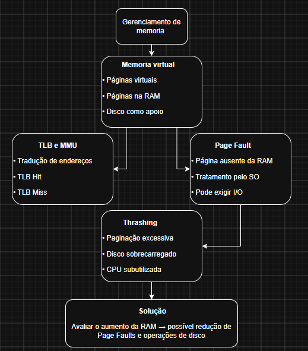

# Diagnóstico de Arquitetura: O Gargalo da Memória Virtual

## Estudo de Caso: O Colapso do Servidor de Dados da TechBuy

## 1. Introdução

O gerenciamento de memória é uma das funções fundamentais de um sistema operacional, pois permite organizar a utilização da memória física e disponibilizar recursos para os processos em execução. Entre os mecanismos utilizados estão a memória virtual, a paginação, a tabela de páginas e a Translation Lookaside Buffer (TLB).

No estudo de caso da empresa TechBuy, o servidor de banco de dados apresenta lentidão durante períodos de alta demanda. A equipe de monitoramento identificou utilização do disco em 100%, baixa utilização da CPU para executar as regras de negócio e frequentes trocas de contexto.

Este parecer técnico tem como objetivo analisar os possíveis motivos desse comportamento, relacionando os sintomas aos conceitos de gerenciamento de memória virtual, faltas de página, paginação excessiva e eficiência da TLB. A fundamentação teórica utiliza as obras de Silberschatz, Galvin e Gagné (2015), Tanenbaum e Bos (2016) e a videoaula da UNIVESP indicada na proposta.

## 2. Parte A — O Fenômeno da Paginação e o Gargalo do Disco

### 2.1 O que é um Page Fault?

O Page Fault, também conhecido como falta de página, é um evento que ocorre quando um processo tenta acessar uma página de memória virtual que não está presente na memória física naquele momento.

A memória virtual permite que os processos utilizem espaços de endereçamento virtuais, enquanto o sistema operacional administra quais páginas permanecem carregadas na memória RAM. Quando uma página solicitada não está residente, o sistema operacional verifica se o acesso é válido e, caso seja, realiza os procedimentos necessários para disponibilizá-la.

Esse procedimento pode envolver a localização da página no armazenamento secundário, a obtenção de uma moldura livre ou a substituição de outra página da memória física. Após a conclusão do tratamento e a atualização das estruturas de gerenciamento, a execução pode ser retomada.

É importante destacar que nem todo Page Fault representa um erro de programação. Uma falta de página pode ser uma ocorrência normal do funcionamento da memória virtual, desde que o acesso solicitado seja válido (SILBERSCHATZ; GALVIN; GAGNÉ, 2015).

### 2.2 Por que o excesso de Page Faults provoca o Thrashing?

O Thrashing, ou paginação excessiva, ocorre quando o sistema passa uma parcela excessiva do seu tempo transferindo páginas entre a memória física e o armazenamento secundário, em vez de executar o trabalho dos processos.

No servidor da TechBuy, esse fenômeno pode ocorrer quando a memória RAM disponível não é suficiente para manter as páginas frequentemente utilizadas pelos processos do banco de dados.

O funcionamento desse problema pode ser explicado pelas seguintes etapas:

1. Os processos do banco de dados solicitam páginas que não estão presentes na RAM.
2. O sistema operacional trata as faltas de página e pode precisar buscar as páginas no armazenamento secundário.
3. Quando não existe espaço suficiente na memória, outras páginas precisam ser substituídas.
4. Se páginas necessárias forem removidas repetidamente, novas faltas poderão ocorrer pouco tempo depois.
5. O servidor passa a realizar operações frequentes de entrada e saída (I/O), aumentando a atividade do disco.
6. Os processos ficam bloqueados enquanto aguardam operações de armazenamento, reduzindo o aproveitamento da CPU.

Consequentemente, a CPU pode permanecer ociosa ou subutilizada enquanto o sistema aguarda a conclusão das operações de I/O. O disco, por sua vez, permanece intensamente ocupado com as transferências de páginas, prejudicando o desempenho geral do servidor.

Esse comportamento é compatível com o fenômeno do Thrashing estudado no gerenciamento de memória virtual (SILBERSCHATZ; GALVIN; GAGNÉ, 2015).

**Diagnóstico da Parte A:** os sintomas apresentados pela TechBuy são compatíveis com uma possível situação de Thrashing. Entretanto, a confirmação exige a análise de métricas como a taxa de faltas de página, a memória disponível e o tempo de espera por operações de disco.

## 3. Parte B — O Papel e a Eficiência da TLB

### 3.1 O que é a TLB e por que ela é implementada em hardware?

A Translation Lookaside Buffer (TLB) é uma memória cache especializada que armazena traduções recentes de endereços virtuais para endereços físicos. Ela está associada à Unidade de Gerenciamento de Memória (MMU), responsável por participar da tradução e do controle dos acessos à memória.

Quando um processo acessa a memória, a tradução necessária pode estar armazenada na TLB. Quando isso acontece, ocorre um TLB hit, permitindo obter a tradução rapidamente.

Quando a tradução não está presente, ocorre um TLB miss. Nesse caso, o sistema precisa consultar a tabela de páginas para localizar a tradução, conforme o mecanismo utilizado pela arquitetura do computador.

A TLB é implementada em hardware porque a tradução de endereços é uma operação frequente e precisa ocorrer com baixa latência. Consultar a tabela de páginas na memória principal a cada acesso acrescentaria custos ao processo de acesso à memória.

Portanto, a TLB melhora a eficiência dos acessos ao manter disponíveis traduções utilizadas recentemente. Ela não substitui a tabela de páginas, mas funciona como um cache especializado dessas informações (TANENBAUM; BOS, 2016).

### 3.2 Como uma alta taxa de TLB miss afeta o servidor?

Uma alta taxa de TLB miss significa que muitas traduções solicitadas não estão disponíveis na TLB. Por isso, o sistema precisa recorrer à tabela de páginas para obter as traduções necessárias, acrescentando trabalho e potencialmente aumentando o tempo de acesso à memória.

Em um servidor de banco de dados, essa situação pode prejudicar o desempenho quando os processos acessam muitas páginas diferentes e a TLB não consegue manter as traduções utilizadas com frequência.

Entretanto, é necessário diferenciar dois eventos: um TLB miss não significa necessariamente um Page Fault. Se a página estiver na RAM, a tradução poderá ser obtida na tabela de páginas sem a necessidade de buscar a página no disco. Se a página não estiver residente, o tratamento de uma falta de página poderá ser necessário (TANENBAUM; BOS, 2016).

### 3.3 O que acontece com a TLB durante uma troca de contexto?

Uma troca de contexto ocorre quando o sistema operacional interrompe a execução de um processo e permite que outro utilize a CPU.

Como processos diferentes podem utilizar espaços de endereçamento virtuais distintos, o sistema precisa impedir que uma tradução pertencente a um processo seja utilizada incorretamente por outro.

Uma das estratégias possíveis é invalidar as entradas da TLB durante a troca de contexto. Isso pode provocar novos TLB misses quando o processo voltar a acessar a memória.

Outra possibilidade é utilizar identificadores de espaço de endereçamento, como ASIDs ou PCIDs, quando a arquitetura oferece suporte. Esses identificadores permitem distinguir traduções pertencentes a diferentes processos, possibilitando preservar determinadas entradas sem realizar uma limpeza completa a cada troca.

Assim, o comportamento da TLB depende da arquitetura do processador e das estratégias utilizadas pelo sistema operacional. Não é correto afirmar que todas as trocas de contexto necessariamente apagam todo o conteúdo da TLB (TANENBAUM; BOS, 2016).

**Diagnóstico da Parte B:** os TLB misses podem aumentar o custo da tradução de endereços e contribuir para a lentidão. Contudo, a elevada utilização do disco relatada pela TechBuy aponta mais diretamente para a necessidade de investigar a ocorrência de paginação excessiva.

## 4. Parte C — Síntese e Solução

### 4.1 Qual seria o impacto de dobrar a quantidade de memória RAM?

A memória virtual permite que os processos utilizem espaços de endereçamento virtuais, enquanto o sistema operacional administra a residência das páginas na memória física.

Se a TechBuy dobrar a quantidade de memória RAM, o servidor poderá manter mais páginas dos processos do banco de dados na memória simultaneamente. Isso poderá reduzir a necessidade de remover páginas que ainda serão utilizadas e diminuir a frequência de faltas de página.

Com menos faltas de página que exigem operações de entrada e saída no disco, a utilização do armazenamento poderá diminuir. Consequentemente, os processos poderão passar menos tempo aguardando transferências de páginas, melhorando o desempenho do servidor.

Entretanto, o aumento da RAM não garante que a taxa de Page Faults cairá pela metade nem que o problema será completamente resolvido. O resultado depende da demanda de memória dos processos, do conjunto de trabalho de cada um e de outros fatores que possam limitar o desempenho.

Por isso, antes e depois da expansão, a equipe de infraestrutura deve monitorar a taxa de faltas de página, a memória disponível, a utilização do disco e o tempo de espera por operações de I/O.

**Recomendação técnica:** caso seja confirmada a insuficiência de memória física como causa da paginação excessiva, aumentar a RAM é uma medida potencialmente eficaz. A intervenção deve ser acompanhada por medições para verificar se houve redução da atividade de disco e melhora no desempenho do banco de dados (SILBERSCHATZ; GALVIN; GAGNÉ, 2015).

## 5. Mapa Mental

Para sintetizar visualmente os conceitos estudados, foi elaborado um mapa mental no draw.io, relacionando os principais elementos do gerenciamento de memória e suas conexões com o problema apresentado no servidor da TechBuy.

O mapa apresenta os conceitos de memória virtual, Page Fault, TLB e MMU, Thrashing e a possível solução por meio da ampliação da memória RAM.

A imagem está incluída neste repositório junto com este documento.

## 6. Conclusão

A análise do caso TechBuy demonstra como o gerenciamento de memória influencia diretamente o desempenho de um servidor de banco de dados.

As faltas de página fazem parte do funcionamento da memória virtual, mas sua ocorrência excessiva pode provocar intensa atividade de armazenamento e contribuir para o Thrashing. Nesse cenário, os processos passam mais tempo aguardando operações de I/O, enquanto a CPU pode ficar subutilizada.

A TLB, por sua vez, acelera a tradução de endereços virtuais para físicos. Uma taxa elevada de TLB misses aumenta o custo das traduções, mas não deve ser confundida com uma falta de página.

Como possível solução, recomenda-se investigar a disponibilidade de memória física e avaliar a expansão da RAM caso seja confirmada a insuficiência de memória como causa do problema. A eficácia da medida deverá ser verificada por meio do monitoramento do servidor.

Conclui-se que o diagnóstico adequado exige compreender a relação entre memória virtual, paginação, TLB e armazenamento, além de validar as hipóteses com métricas reais de desempenho.

## 7. Referências

SILBERSCHATZ, Abraham; GALVIN, Peter Baer; GAGNÉ, Greg. **Fundamentos de sistemas operacionais**. 9. ed. Rio de Janeiro: LTC, 2015.

TANENBAUM, Andrew S.; BOS, Herbert. **Sistemas operacionais modernos**. 4. ed. São Paulo: Pearson Education do Brasil, 2016.

UNIVERSIDADE VIRTUAL DO ESTADO DE SÃO PAULO (UNIVESP). **Sistemas Operacionais – Aula 17 – Introdução ao Gerenciamento de Memória**. YouTube, 2016. Disponível em: https://www.youtube.com/watch?v=7zT0oGVKyF8. Acesso em: 15 out. 2026.
